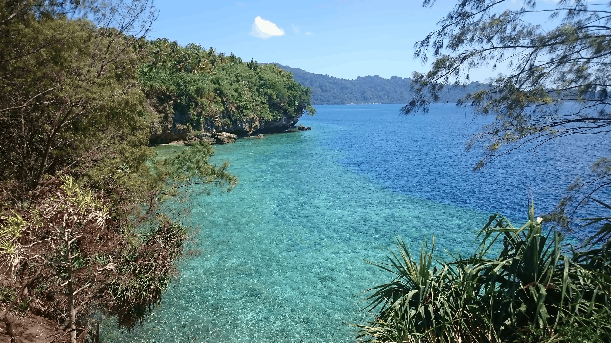

<div align="center">
  

  <p><strong>A little history. A little sea. A slower way to travel.</strong></p>

  <p>A Banda Neira travel website built for the<br />Front End Basic Final Project at <strong>Veterantech</strong>.</p>

  <p>HTML · Tailwind CSS · JavaScript · GSAP</p>
</div>



## About the project

BANDA. introduces Banda Neira and its neighboring islands through photography, local history, and practical travel information. Its warm paper backgrounds, handwritten headings, and coastal colors take inspiration from a travel journal.

The website uses vanilla HTML and JavaScript, with Tailwind CSS for styling and GSAP for scroll animations.

## Explore the website

| Page | What you’ll find |
| --- | --- |
| **Home** | Fort Belgica, views across the bay, nearby islands, and sunset over Gunung Api. |
| **Island Map** | An interactive map of Banda Neira, Gunung Api, Banda Besar, Pulau Run, Pulau Ai, and Pulau Hatta. Select an island to discover its attractions and open their locations in Google Maps. |
| **Visit Guide** | Getting to Banda, admission and opening-hour information, frequently asked questions, and a contact form. |

## Features

- Responsive layouts with a desktop sidebar and mobile bottom navigation.
- Interactive island selection with matching photos and destination details.
- Scroll-linked hero motion and section entrance animations.
- Reduced-motion support for visitors who prefer fewer animations.
- Contact form validation that opens a prefilled message in the visitor’s email app.
- WebP photography and SVG icons.

## Built with

| Technology | Purpose |
| --- | --- |
| HTML | Semantic page structure |
| Tailwind CSS & CSS | Layout, responsive styling, and visual details |
| Vanilla JavaScript | Navigation, island selection, and form validation |
| GSAP & ScrollTrigger | Scroll animations |
| Lucide | Interface icons |
| Vite | Local development and production builds |

## Run locally

Install Node.js 22.12 or newer, then run these commands from the project folder:

```sh
npm install
npm run dev
```

Open the local address printed in the terminal.

To build and preview the production version:

```sh
npm run build
npm run preview
```

The production files are generated in `dist/`.

## Project structure

```text
├── index.html             Home
├── island-map.html        Interactive island map
├── visit-guide.html       Travel guide and contact
├── assets/images/         Photography, logo, and decorations
├── public/favicons/       Browser and device icons
├── src/
│   ├── scripts/           Interactions and animations
│   └── styles/            Shared and page-specific styles
├── package.json
└── vite.config.js
```

## Project scope

This is a frontend project. The contact form prepares an email through `mailto:`; visitors send it using their email app. Travel costs and opening hours are planning information and should be confirmed locally.

Photographs belong to their respective creators and remain subject to their original licenses.

---

**Muhammad Adla Fayyaz Fauzy**  
[GitHub](https://github.com/adlafayyaz) · [LinkedIn](https://www.linkedin.com/in/adlafayyaz/)
